# NYC Bike Infrastructure Analysis: Charts and Maps

These pre-rendered figures are included so readers can view the project results directly on GitHub. The source code and instructions are in the [project README](../README.md).

The figures were produced from 2,199 census tracts with usable household-income estimates. The underlying raw datasets are not included in this repository. The analysis used the ACS 2024 five-year income table, the NYC 2020 census tract boundaries, and the NYC Bike Routes snapshot available to the project when it was run. The source pages are [ACS data](https://data.census.gov/), [NYC 2020 Census Tracts](https://data.cityofnewyork.us/City-Government/2020-Census-Tracts/63ge-mke6), and [NYC Bike Routes](https://data.cityofnewyork.us/dataset/New-York-City-Bike-Routes/mzxg-pwib). Later downloads may differ, especially for bike routes.

## Maps

### Household income and protected bike routes

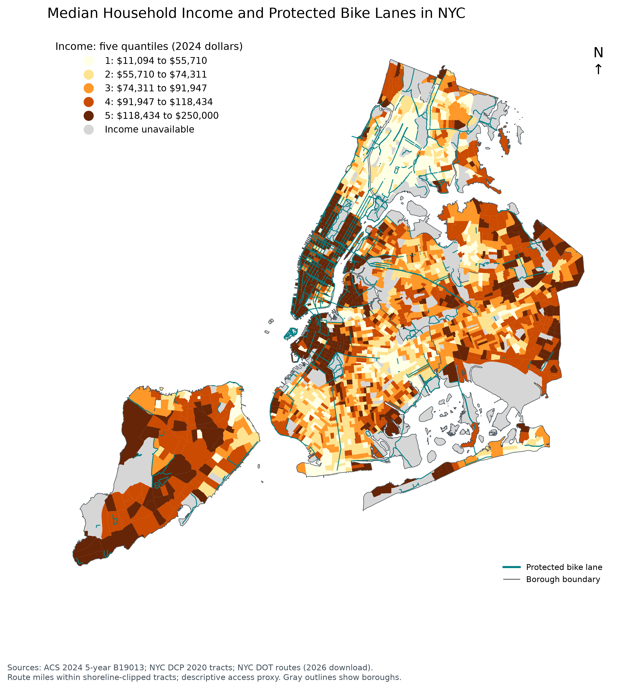

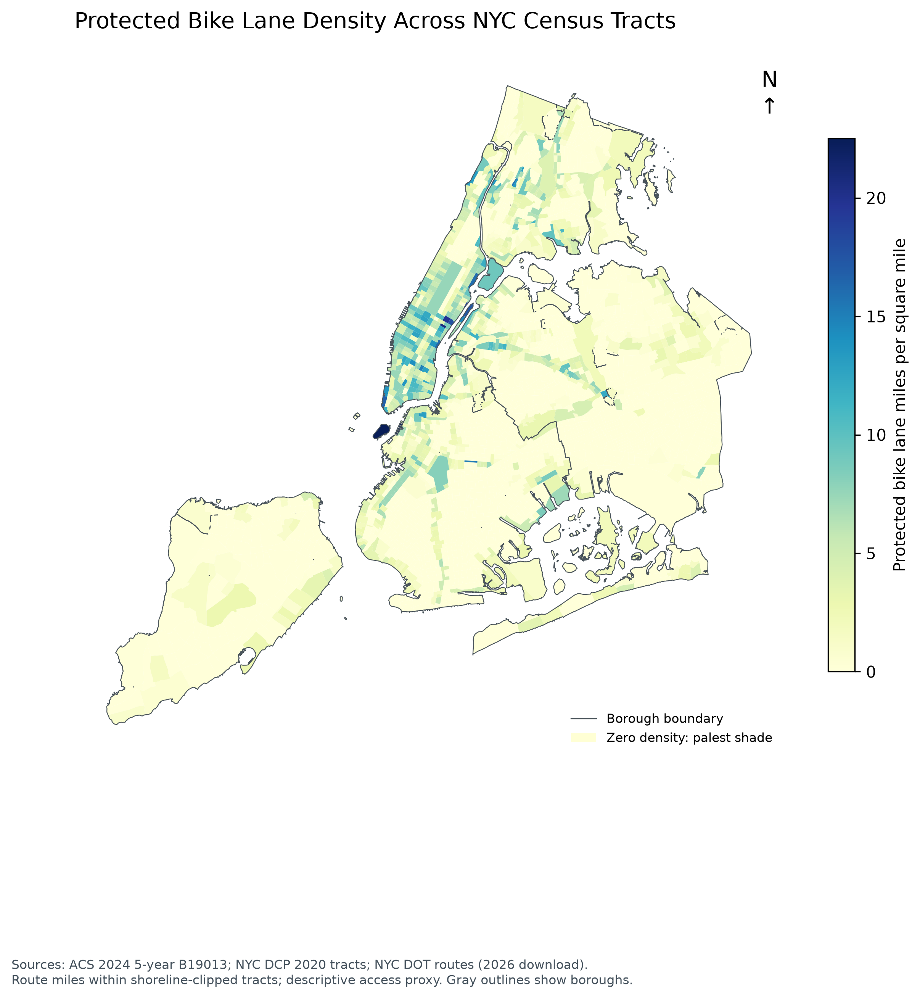

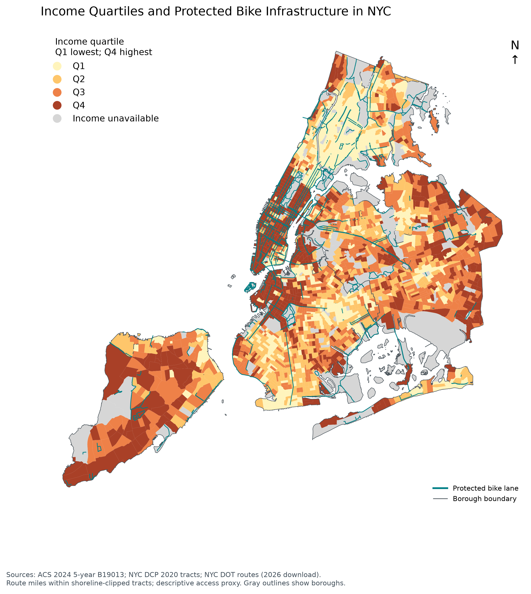

### Bike infrastructure types

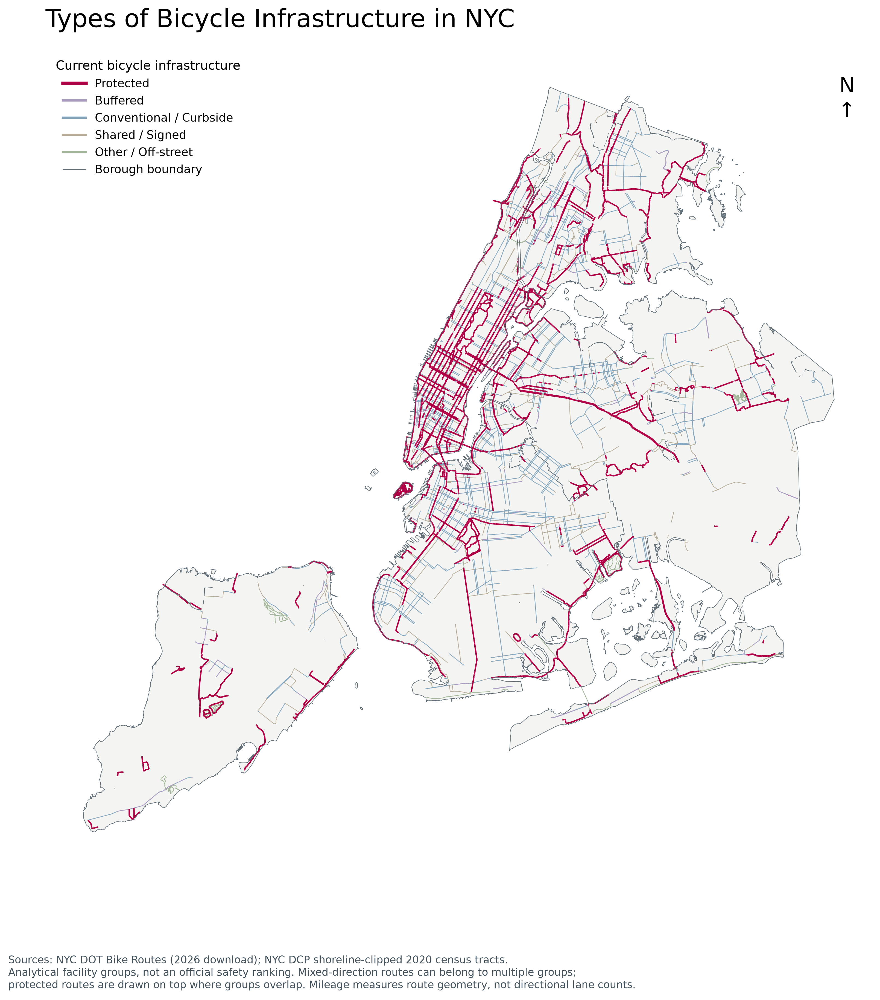

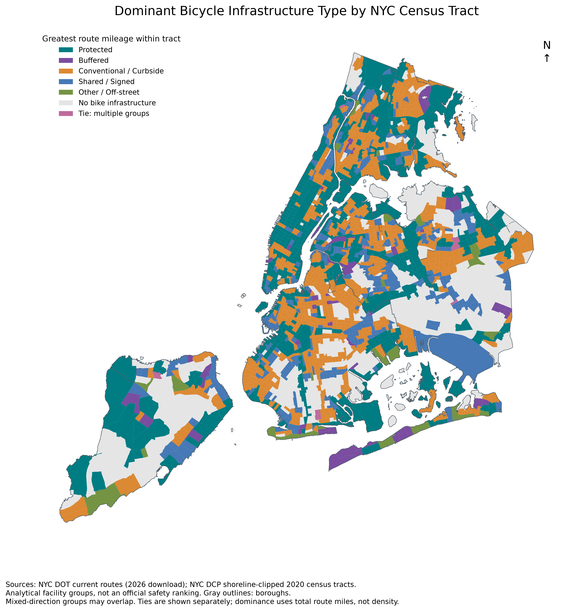

The [maps gallery](maps/maps.html) and [facility types gallery](maps/facility_types.html) can also be downloaded with the PNG files and opened locally in a browser.

## Analysis charts

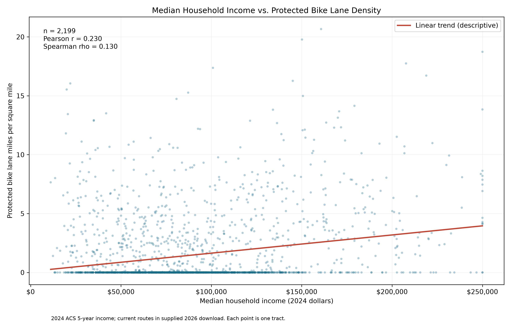

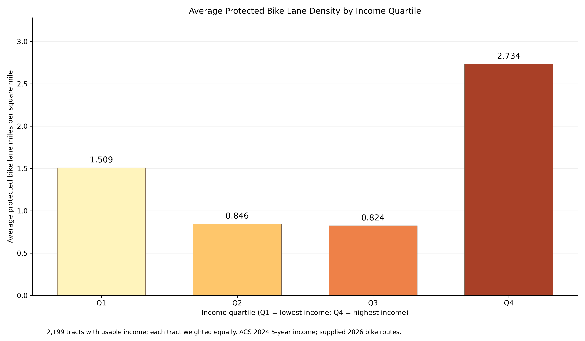

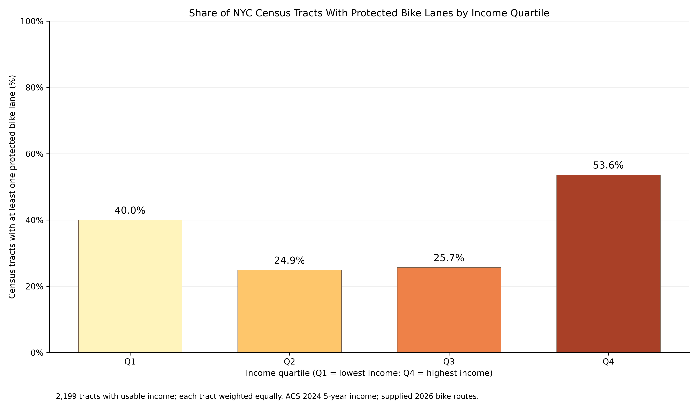

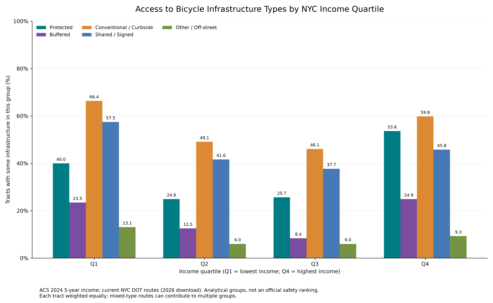

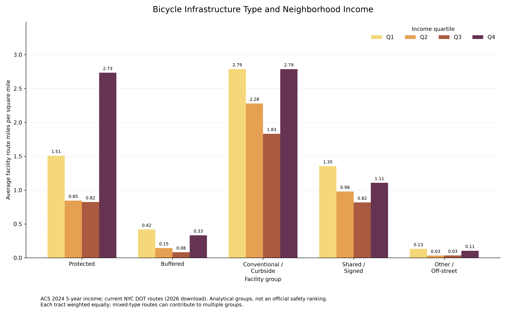

Supporting summaries: [income and protected access](charts/income_quartile_bike_access.csv), [facility type by income](charts/bike_facility_type_by_income.csv), and [infrastructure mileage summary](maps/bike_infrastructure_type_summary.csv).

## Presentation charts

The five presentation charts are available as PNG and editable SVG files, with a [combined PDF](presentation/all_five_charts.pdf). A [gallery page](presentation/gallery.html) is included for local viewing alongside the image files.

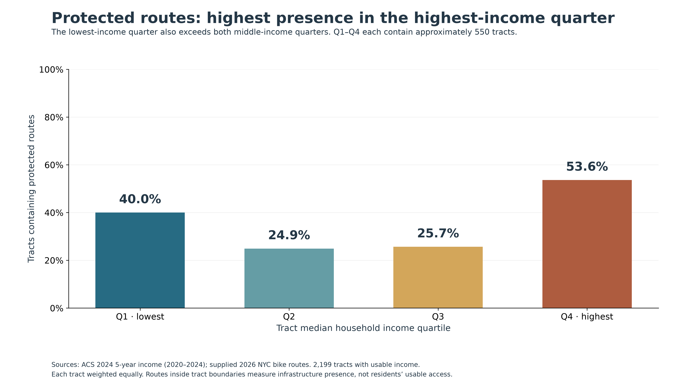

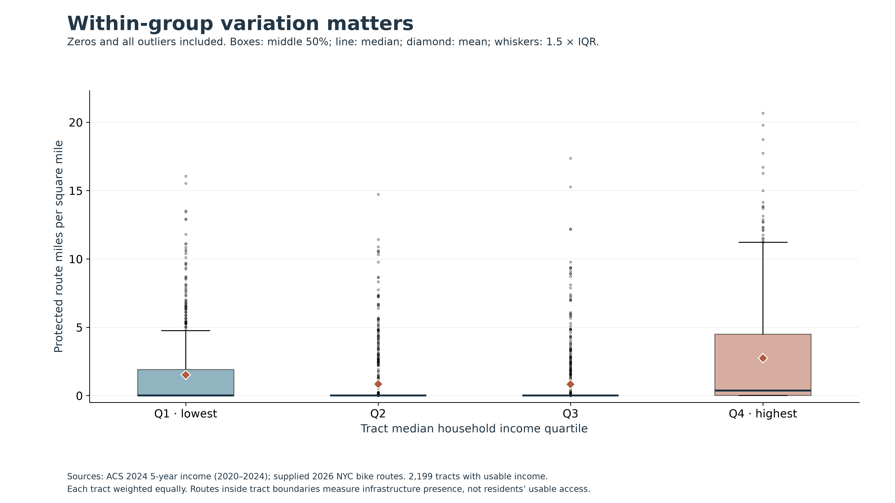

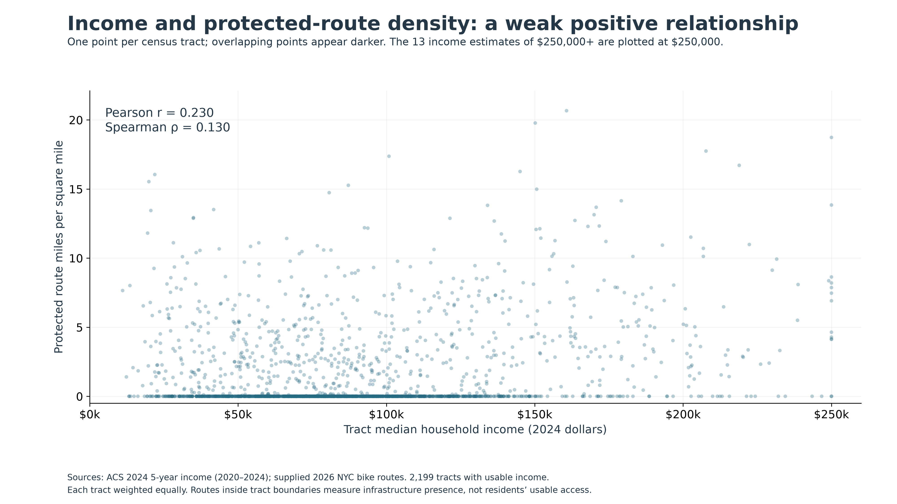

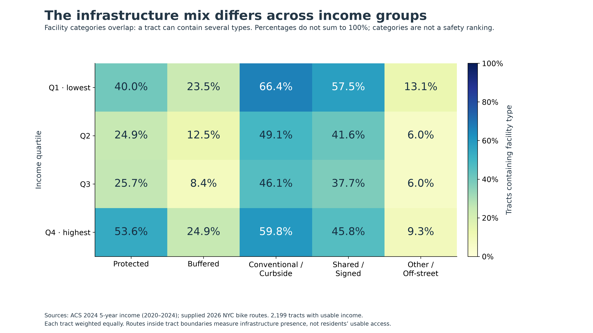

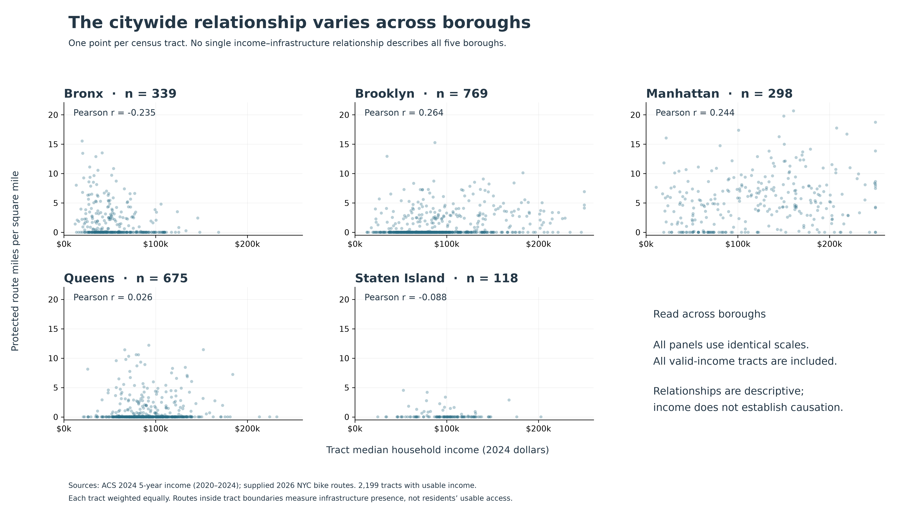

## Interpretation

These are tract-level comparisons. Route mileage inside a tract does not measure how many people use a route, how easy it is to reach, or how safe riders feel.
